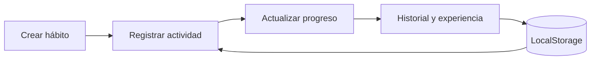

<div align="center">

# HabiTracker

### Seguimiento de hábitos con progreso visual y gamificación

   

</div>

## Descripción

Aplicación web interactiva para organizar hábitos, registrar avances y visualizar la consistencia diaria. La experiencia incorpora perfiles, avatares personalizables y recompensas virtuales.

## Características

| Función | Descripción |
| --- | --- |
| Gestión de hábitos | Crear, completar, filtrar y eliminar hábitos |
| Progreso | Indicadores de cumplimiento y rachas |
| Historial | Resumen de actividad semanal |
| Gamificación | Experiencia, niveles y rangos |
| Personalización | Avatares SVG y perfil editable |
| Persistencia | Datos guardados en el navegador |

## Flujo de la aplicación



## Estructura

```text
habit-tracker/
├── index.html       Interfaz principal
├── css/styles.css   Estilos y diseño
└── js/app.js        Lógica, estado y persistencia
```

## Ejecutar localmente

```bash
git clone https://github.com/rodridarklau/habit-tracker.git
cd habit-tracker
```

Abrir `index.html` en un navegador moderno. También puede utilizarse un servidor estático local. No se requiere base de datos ni instalar dependencias.

## Privacidad y alcance

Los datos se guardan en LocalStorage del navegador; no hay sincronización con un servidor ni respaldo automático. No se recomienda almacenar información sensible. El progreso puede perderse si se borran los datos del sitio.

## Próximas mejoras

- Pruebas automatizadas de fechas y rachas.
- Validación de entradas y recuperación de almacenamiento.
- Revisión de accesibilidad y publicación de una demostración.

## Créditos

Proyecto de desarrollo web. Consultar el historial de Git para las contribuciones.
